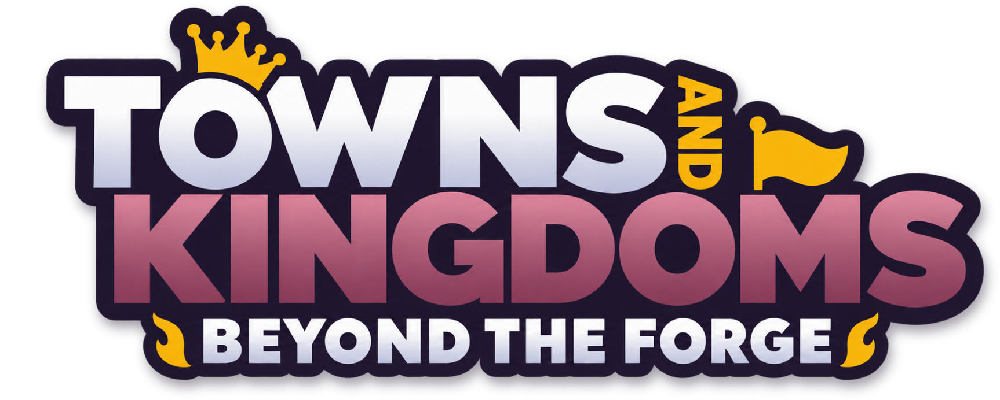

  

Towns & Kingdoms: Beyond the Forge is a Minecraft modpack combining Create automation, RPG combat, magic and exploration. Build a settlement, connect its workshops, and discover equipment and resources through dungeons and boss encounters.

  <strong><a href="https://mikaaah.github.io/TownsAndKingdoms/">Open the Towns &amp; Kingdoms Wiki →</a></strong>

  <a href="https://discord.gg/CRYk3uDPVt">Discord</a> · <a href="https://www.curseforge.com/minecraft/modpacks/towns-kingdoms">CurseForge</a>

